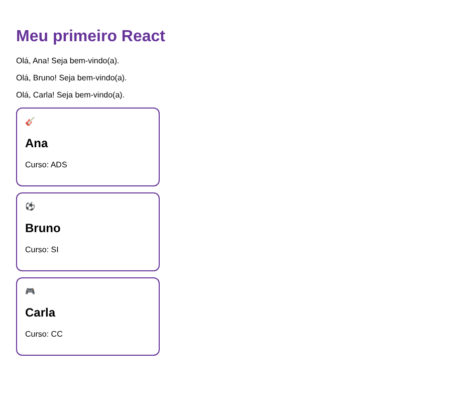

# ROTEIRO PRÁTICO: MEU PRIMEIRO REACT

*Um passo de cada vez. Só avance quando o ✅ do passo estiver verdadeiro.*

**Programação Web — Aula 15 de 20 · React I — Componentes e Props**

## 🎯 MISSÃO

Sair do zero e terminar com uma página React feita por mim, com componentes próprios recebendo informações por props.

- Parte 1 (Passos 1 a 5): antes da explicação do professor. Parte 2 (Passos 6 a 12): depois.
- Digitar o código em vez de copiar e colar.
- Alguns passos mandam provocar um erro de propósito: fazer e ler a mensagem antes de corrigir.

**⏱️ Tempo:** Parte 1: 40 min · Parte 2: 75 min     **👥 Formato:** individual, conferindo cada passo com o colega ao lado

**Nome:** Arthur de Souza Monteiro
**Turma:** pw-2026.2
**Data:** 16/10/2026

> O projeto completo está em [`meu-primeiro-react/`](meu-primeiro-react/). Fiz no StackBlitz (Node rodando no navegador), com os mesmos comandos do roteiro. Para rodar no computador: `cd meu-primeiro-react`, `npm install` e `npm run dev`.

---

## PASSO 01 — Conferir se o Node está instalado

```bash
node --version
npm --version
```

✅ Apareceram os dois números de versão.

## PASSO 02 — Criar o projeto

```bash
npm create vite@latest meu-primeiro-react -- --template react
```

Respondi `y` no *Ok to proceed?*, escolhi um linter na pergunta nova do Vite e **No** em *Install with npm and start now?*.

✅ Terminou com **Done** e apareceu a pasta `meu-primeiro-react`.

## PASSO 03 — Instalar e ligar o projeto

```bash
cd meu-primeiro-react
npm install
npm run dev
```

✅ Apareceu a página de demonstração do Vite com **Get started** e o botão **Count is 0**, e clicar no botão aumenta o número.

## PASSO 04 — Conhecer os três arquivos que importam

```text
index.html  →  src/main.jsx  →  src/App.jsx
tem uma caixa  pega a caixa e    diz o que aparece
vazia          coloca o App dentro
```

✅ Achei `<div id="root"></div>` no `index.html`, `root` e `<App />` no `main.jsx` e o `return` no `App.jsx`.

**O que existe DENTRO do `<div id="root">` no index.html? Então quem coloca o conteúdo na página?**

Não existe nada, a div está vazia. Quem coloca o conteúdo é o JavaScript: o `main.jsx` pega o `root` e coloca o `<App />` dentro dele, e o `return` do `App.jsx` diz o que aparece.

## PASSO 05 — O Hello World 🎉

```jsx
function App() {
  return <h1>Olá, mundo!</h1>;
}

export default App;
```

E esvaziei o `src/index.css`.

✅ A tela mostrou só **Olá, mundo!** no canto de cima à esquerda e mudou sozinha quando salvei.

`App` é só uma função JavaScript que devolve um pedaço de tela. Isso é um **componente**.

## PASSO 06 — Mais de um elemento (e o primeiro erro de propósito)

```jsx
return <h1>Olá, mundo!</h1><p>Meu primeiro React</p>;
```

Deu o erro **Adjacent JSX elements must be wrapped in an enclosing tag**: o `return` só pode devolver **um** elemento. Corrigi embrulhando em uma `<div>` e depois em um Fragment (`<>` e `</>`), que embrulha sem criar uma div a mais na página.

✅ Vi o erro, e com `<div>` e com `<>` apareceram o título e o parágrafo.

## PASSO 07 — Chaves { }: colocar JavaScript na tela

```jsx
const nome = "Arthur";
const ano = 2026;

<h1>Olá, {nome}!</h1>
<p>Em {ano + 1} eu já vou saber React.</p>
<p>Seu nome gritado: {nome.toUpperCase()}</p>
```

✅ Apareceram o nome, o ano 2027 e o nome em MAIÚSCULAS.

**Apague as chaves de `{nome}` e deixe só `Olá, nome!`. O que aparece na tela?**

Aparece a palavra **nome** escrita. Sem as chaves, o React trata como texto comum; com as chaves, ele busca o valor da variável `nome`.

## PASSO 08 — Estilo com className

```jsx
<h1 className="titulo">Olá, {nome}!</h1>
```

```css
body { font-family: sans-serif; padding: 24px; }
.titulo { color: rebeccapurple; }
```

No JSX é `className` porque `class` é palavra reservada do JavaScript.

✅ O título ficou roxo e a fonte mudou. Quem carrega o `index.css` é o **`src/main.jsx`**, na linha `import './index.css'`.

## PASSO 09 — O seu primeiro componente

```jsx
function Saudacao() {
  return <p>Olá! Seja bem-vindo(a).</p>;
}
// no App: <Saudacao /> três vezes
```

✅ A mensagem de boas-vindas apareceu três vezes.

**Erro de propósito: `function saudacao()` e `<saudacao />` (minúsculo). O que aparece na tela? E no Console?**

Na tela não aparece nada. No Console:

```text
The tag <saudacao> is unrecognized in this browser. If you meant to render a React component, start its name with an uppercase letter.
```

Com minúscula o React acha que é uma tag HTML, e essa tag não existe. A letra maiúscula é como ele sabe que é um componente.

## PASSO 10 — Props: mandar informação para o componente

```jsx
function Saudacao(props) {
  return <p>Olá, {props.nome}! Seja bem-vindo(a).</p>;
}
// <Saudacao nome="Ana" />  <Saudacao nome="Bruno" />  <Saudacao nome="Carla" />
```

✅ Apareceram três saudações, cada uma com um nome diferente.

**Acrescente um quarto `<Saudacao />` SEM o atributo nome. O que aparece no lugar do nome? Deu erro?**

Não deu erro. Apareceu `Olá, ! Seja bem-vindo(a).`, com um espaço vazio no lugar do nome, porque `props.nome` fica `undefined` e o React não mostra nada para `undefined`.

## PASSO 11 — Um componente por arquivo

Movi a função para [`src/components/Saudacao.jsx`](meu-primeiro-react/src/components/Saudacao.jsx) com `export default Saudacao;` e importei no `App.jsx`:

```jsx
import Saudacao from "./components/Saudacao";
```

`export default` = "este arquivo oferece este componente". `import` = "quero usar o componente daquele arquivo".

✅ A tela continuou igual ao passo 10 e o `App.jsx` ficou só com o import no topo.

## PASSO 12 — Desafio: o CartaoPerfil

[`src/components/CartaoPerfil.jsx`](meu-primeiro-react/src/components/CartaoPerfil.jsx):

```jsx
function CartaoPerfil(props) {
  return (
    <div className="cartao">
      <span>{props.emoji}</span>
      <h2>{props.nome}</h2>
      <p>Curso: {props.curso}</p>
    </div>
  );
}

export default CartaoPerfil;
```

No [`App.jsx`](meu-primeiro-react/src/App.jsx):

```jsx
<CartaoPerfil nome="Ana" curso="ADS" emoji="🎸" />
<CartaoPerfil nome="Bruno" curso="SI" emoji="⚽" />
<CartaoPerfil nome="Carla" curso="CC" emoji="🎮" />
```

E a classe `.cartao` no [`index.css`](meu-primeiro-react/src/index.css) com borda, `padding` e `border-radius`.

✅ Três cartões aparecem, cada um com nome, curso e emoji diferentes; o componente está em `src/components/CartaoPerfil.jsx` e é importado no `App.jsx`.

**Print da tela:**


